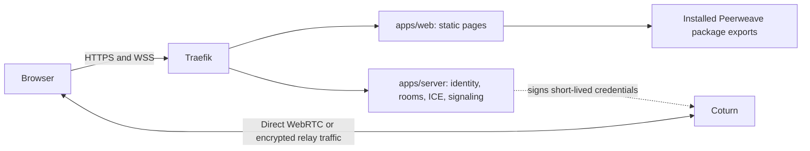

# Architecture

This is an independent private-access application, not another framework workspace. It consumes the
four Peerweave 0.1.0 package artifacts recorded in [vendor provenance](vendor/peerweave/manifest.json).
No build, test or deployment requires the sibling framework checkout. Only the explicit vendor
update command reads it. Installed package export boundaries are enforced by `pnpm check:repo`.

`apps/web` owns rendering, application readiness/invitations, file transfer and disposable runtime
controllers. Its four starting pages originated in Peerweave's reference samples; this repository
now owns their implementation and original browser/model/protocol regressions. The framework
keeps a separate minimal vanilla video page, so the richer UI has one source of truth here.
Pure Gyral models/views depend on serializable state; controllers retain tracks, peers and URLs.

`apps/server` owns the authenticated HTTP API and two-member WebSocket room relay. Room policy
is operator-managed. Production receives authenticated identity through Traefik and has no
published host port. TURN credentials and room joins share the same authorization policy.
The server keeps rooms and rate limits in memory: use one instance, and expect rejoin on restart.

`deploy/traefik` owns edge TLS and HTTP authentication; `deploy/turn` owns native relay policy.
Coturn runs on the Linux host network. Traefik and the app share an external Docker network;
Docker API discovery uses a separate restricted proxy network. Compose deploys images only.
See the [ordered deployment guide](docs/webrtc-production.md) for shared-IP ports and packet flow.

`tools` owns development lifecycle, isolated browser/Docker checks, package-artifact updates and
repository invariants. `tests` verifies application boundaries rather than reimplementing library
unit suites. `.artifacts` contains disposable logs/screenshots; no private runtime files are tracked.
