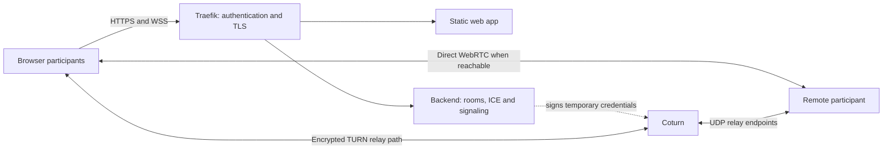

# Peerweave Deployment Example

[](https://github.com/peerweavejs/peerweave-deployment-example/actions/workflows/ci.yml)
[](LICENSE)
[](https://www.typescriptlang.org/)
[](compose.yaml)

**A self-hosted Peerweave reference app with authenticated signaling, room authorization and short-lived TURN credentials.**

Four browser examples, an application-owned backend, and standalone Traefik/Coturn deployment
projects show how to take [Peerweave](https://github.com/peerweavejs/peerweave) beyond localhost.
The source is MIT licensed; the deployed application uses private, operator-managed access.

[Quick start](#quick-start) · [Architecture](ARCHITECTURE.md) ·
[Deployment guide](docs/webrtc-production.md) · [Security](SECURITY.md) ·
[Contributing](CONTRIBUTING.md)

## Why a separate deployment example?

A browser framework and a deployed calling application have different responsibilities. This
repo demonstrates the application work around WebRTC: identifying users, authorizing rooms,
issuing expiring ICE credentials, routing WSS, operating TURN and checking the real packet path.

The framework repo owns library APIs, native contracts and one minimal vanilla video sample. This repo owns
the richer app, operational policy, container images and infrastructure. The framework keeps
one small vanilla TypeScript video example. This app consumes
packaged public APIs and can build without a sibling framework checkout.

## What is included?

| Component | Responsibility |
| --- | --- |
| `apps/web` | Four Gyral 0.3.7 pages: calls/chat, media preflight, accepted file transfers and support invitations |
| `apps/server` | Trusted proxy identity, explicit room membership, authorized ICE leases and two-member signaling |
| [`compose.yaml`](compose.yaml) | Prebuilt static-web and backend images; no published app ports |
| [`compose.traefik.yaml`](compose.traefik.yaml) | HTTPS/WSS, ACME state, private BasicAuth and restricted Docker discovery |
| [`compose.turn.yaml`](compose.turn.yaml) | Authenticated Coturn, TLS, relay restrictions and allocation/bandwidth limits |
| `vendor/peerweave` | Reviewed private package archives with checksums and source provenance |
| `tools`, `tests`, `docs` | Isolated checks, image builds, plans, architecture and operating guidance |

This is a single-host, private-access reference. It does not include public signup, room discovery,
recording, SFU conferencing or durable sessions. Review the [product scope](docs/product-specs/index.md)
and [measured quality](docs/QUALITY_SCORE.md); local tests do not establish public reachability.

## Quick start

Use Node 24+ and the pnpm version pinned in `package.json`:

```sh
git clone https://github.com/peerweavejs/peerweave-deployment-example.git
cd peerweave-deployment-example
pnpm install --frozen-lockfile
pnpm exec playwright install --with-deps chromium
pnpm dev
```

Open `http://127.0.0.1:5173` in two tabs and use room `hello`. Join both, then start the call in
each tab. The other pages are `/media/`, `/transfer/` and `/support/`. Development is explicitly
loopback-only, with one local identity and direct-only ICE when no TURN fixture is configured.
Production mode requires real identity, membership and TURN configuration; it never silently
falls back to development access. See [development](docs/DEVELOPMENT.md).

## Architecture and data flow



1. Traefik authenticates the HTTP request and supplies verified identity to the unpublished backend.
2. The backend authorizes the requested room and returns a short-lived ICE lease without its shared secret.
3. The browser validates the lease, then joins that room over same-origin WSS.
4. ICE selects a working direct or relay path; signaling does not carry media/file contents.
5. Leaving cancels pending setup and disposes owned resources. Session expiry requires rejoining.

Rooms and rate limits live in one backend process. The [architecture](ARCHITECTURE.md),
[security boundary](docs/SECURITY.md) and [reliability contract](docs/RELIABILITY.md) explain the limits.

## Configuration and deployment

Follow the **[ordered production guide](docs/webrtc-production.md)** for DNS, firewall/NAT rules,
private file permissions, certificates, membership, startup, verification and renewal. Start with:

```sh
cp .env.example .env
cp .env.traefik.example .env.traefik
cp .env.turn.example .env.turn
```

Edit these files and provision their private files before starting containers:

| Configuration | Key values |
| --- | --- |
| App `.env` | Public hostname, image tag, shared network, room-policy file, backend secret copy and public TURN URLs |
| Traefik `.env.traefik` | Shared Docker network, Docker socket path and bcrypt user-file path |
| Coturn `.env.turn` | TURN hostname, public/local relay IPv4, certificate directory, secret file and quotas |
| Room policy | Exact usernames per room; the template includes `hello`, `support-hello` and `files-hello` |

All three Compose projects deploy images only. [The shell script](tools/build-images.sh) builds
app images separately; the [image guide](docs/deploying.md) covers registry transfer and updates.

```sh
./tools/build-images.sh
# After completing the guide's bootstrap and private-file configuration:
docker compose --env-file .env.traefik -f compose.traefik.yaml up -d --wait
docker compose --env-file .env.turn -f compose.turn.yaml up -d --wait
docker compose up -d --wait
```

On one public IP, Traefik owns TCP 80/443; Coturn uses UDP/TCP 3478, TCP 5349 and a bounded UDP
relay range. Optional SNI passthrough shares TCP 443 with TURN/TLS. A TURN hostname must have a
native DNS/network path; a normal HTTP tunnel does not carry its UDP relay traffic.

## Build and test

```sh
pnpm exec playwright install --with-deps chromium firefox webkit
pnpm build                 # Compile the web app and backend
pnpm check                 # Lint, boundaries, types, coverage, browser regressions and native app smoke
pnpm build:images          # Build the two runtime images
pnpm test:deployment       # Linux/Docker: actual authenticated Traefik HTTPS/WSS
pnpm test:turn:deployment  # Linux/Docker: UDP/TCP/TLS, SNI and relay-only app traffic
```

The tests verify denied credentials/rooms, native video/chat/hangup, exact file bytes and selected
relay candidates. TURN checks exercise invalid/expired auth, blocked peers, TLS and ICE restart.
Fixtures clean up their temporary Docker resources. Read [testing](docs/TESTING.md) and the
[quality record](docs/QUALITY_SCORE.md) for coverage scope, screenshots and external acceptance gaps.

## Updating Peerweave artifacts

The framework packages are unpublished previews. This repo includes versioned archives so a fresh
clone remains reproducible. [The manifest](vendor/peerweave/manifest.json) records their source and SHA-256 hashes.

```sh
pnpm vendor:peerweave /absolute/path/to/peerweave
pnpm install --frozen-lockfile
pnpm check
```

The update command requires clean framework package sources, builds/packs public exports and updates
dependency versions, overrides and the lockfile. Review that diff explicitly. Normal install/build
never imports framework sources; npm publication remains a separate framework release decision.

## Conventions and contributions

Keep production auth and room policy in this app, import installed Peerweave exports, keep secrets
outside images/logs, and let disposable controllers own browser resources. UI models remain pure.
Use behavior-first tests, preserve regressions, and record decisions/results in versioned docs.
The short [`AGENTS.md`](AGENTS.md), [design index](docs/design-docs/index.md) and [plans](docs/PLANS.md)
provide the harness navigation map.

Read [CONTRIBUTING.md](CONTRIBUTING.md), follow the [code of conduct](CODE_OF_CONDUCT.md), and use
[GitHub Issues](https://github.com/peerweavejs/peerweave-deployment-example/issues) for non-sensitive
bugs and proposals. Report vulnerabilities privately using [SECURITY.md](SECURITY.md).

## License

Application source and vendored Peerweave packages are [MIT licensed](LICENSE). Fonts retain their
OFL notices; external references and dependency licenses retain their owners' terms. See
[third-party notices](THIRD_PARTY_NOTICES.md).
