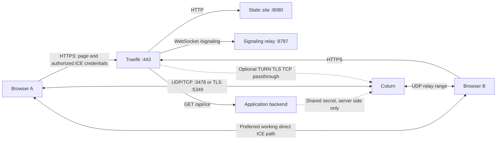

# Run Peerweave with Traefik and Coturn

This guide describes a single Linux server with one public IPv4 address, two DNS names
(`calls.example.com` and `turn.example.com`), and three independent Compose projects. The app
and Traefik share the external `traefik` Docker network. Coturn uses the Linux host network.
All Compose files reference images; application images are built by `tools/build-images.sh`.
Run the commands from the repository root. For a server without a checkout, copy the Compose
files and the `deploy/app`, `deploy/traefik` and `deploy/turn` configuration/script trees, supply the private
files on that server, and transfer the application images as described in the app deployment guide.

This application includes a working authenticated ICE endpoint and room authorization. The
supplied configuration is for a private, operator-managed deployment: Traefik BasicAuth identifies
users, and a private JSON file defines their permitted rooms. It has no public account signup,
room discovery or self-service invitation service. [Security boundary](SECURITY.md).

## Architecture and data flow



1. The browser loads the page over HTTPS. The supplied Traefik configuration authenticates
   HTTP requests before routing them. BasicAuth is available for a small private deployment;
   OIDC/ForwardAuth is the recommended next step for MFA and user lifecycle management.
2. The backend trusts the authenticated proxy identity, authorizes room membership and issues a temporary
   ICE-server configuration. It signs a timestamped TURN username using the shared server
   secret. The browser receives a temporary credential, never the shared secret.
3. Both participants join the same example/room over WSS. Signaling carries offers, answers,
   ICE candidates and application invitation/readiness messages. It carries neither camera
   frames nor file contents.
4. Each browser gathers ICE candidates: local host candidates, server-reflexive addresses
   learned through STUN, and relay addresses allocated through TURN. Gathering and connectivity
   checks can overlap; ICE evaluates candidate pairs rather than following a fixed serial
   “try STUN, then start TURN” sequence. [ICE specification](https://www.rfc-editor.org/rfc/rfc8445.html)
5. ICE selects a working pair. Direct connectivity avoids relay bandwidth. A TURN allocation
   supplies a reachable relay when the direct paths fail. Both endpoints may need TURN.
6. WebRTC negotiates encrypted media/data transports. In this one-to-one design, TURN forwards
   encrypted packets; it still sees traffic timing, IP addresses and bandwidth. Signaling and
   participant identity remain security-critical. TURN does not verify who the remote human is.
7. A network change may require an ICE restart and fresh usable credentials. The current
   signaling transport reconnects by creating a new channel/session; it does not resume an
   existing call. Ending a call releases owned resources. Server restarts can end active sessions.

## 1. Prepare the server, DNS and firewall

Use Linux Docker Engine and a recent Compose plugin; rootful Docker is the production baseline
for host networking and public ports 80/443. The smoke tests also detect a local rootless Docker
socket, but rootless host-network/public-port behavior needs separate validation on your host.
Install OpenSSL and `htpasswd` (commonly the `apache2-utils` package) for bootstrap operations.

Create DNS-only A records for both names pointing at the server's public IPv4. Keep the TURN
record outside a normal Cloudflare HTTP proxy or HTTP Tunnel. A TURN client needs its native
TCP/UDP path. Do not publish AAAA until IPv6 listeners, relay addresses, firewall rules and
external tests are configured; this template is an IPv4 baseline.

| Inbound port | Purpose | Destination |
| --- | --- | --- |
| TCP 80 | Traefik HTTP redirect and ACME HTTP-01 | Traefik |
| TCP 443 | App HTTPS/WSS; optional SNI-based TURN TLS passthrough | Traefik |
| UDP 3478 | STUN and preferred TURN client transport | Coturn |
| TCP 3478 | TURN client fallback | Coturn |
| TCP 5349 | Native TURN/TLS client fallback | Coturn |
| UDP 49160–49999 | Coturn allocated relay endpoints | Coturn |

Do not open UDP 5349 for this configuration: DTLS listeners are disabled. The relay-to-peer leg
uses UDP even when the browser-to-TURN leg uses TCP or TLS. `no-tcp-relay` disables RFC 6062
TCP peer relays; it preserves browser-to-Coturn TCP/TLS support. Open the relay range in both
the host firewall and the provider security group. Permit stateful return traffic and outbound
UDP to public peer candidate addresses/ports; peer ports are not confined to your relay range.
Apply anti-spoofing/DDoS controls at the provider edge. [TURN protocol](https://www.rfc-editor.org/rfc/rfc8656.html)
Docker-published bridge ports can bypass UFW's normal filtering path. Use the appropriate Docker
forwarding controls/provider firewall and test from outside; Coturn's host-network ports instead
follow the host's own networking rules. [Docker firewall behavior](https://docs.docker.com/engine/network/packet-filtering-firewalls/)

Behind 1:1 NAT, `TURN_RELAY_IP` is the address actually assigned to the server and
`TURN_PUBLIC_IP` is the public address. Forward listener ports and the entire UDP relay range
without changing port numbers. Coturn advertises that public mapping; an incorrect mapping
produces apparently successful allocations with unusable candidates. Avoid another NAT or
an HTTP load balancer between the Internet and the relay ports. [Coturn container networking](https://github.com/coturn/coturn/blob/master/docker/coturn/README.md)

Create the shared network once:

```sh
docker network create traefik
cp .env.traefik.example .env.traefik
cp .env.turn.example .env.turn
cp .env.example .env
```

Edit the files with your actual names, addresses and paths. `.env.turn` and `.env.traefik`
must be passed explicitly with `--env-file`; Compose otherwise reads `.env`.

## 2. Start the standalone Traefik project

Files: [compose.traefik.yaml](../compose.traefik.yaml),
[traefik.yaml](../deploy/traefik/traefik.yaml),
[security middleware](../deploy/traefik/dynamic/security.yaml), and
[optional TURN TCP routing](../deploy/traefik/dynamic/turn.yaml).

Generate a bcrypt user file without putting the password in command-line arguments:

```sh
edge_setup_dir=$(mktemp -d)
chmod 700 "$edge_setup_dir"
htpasswd -nB alice > "$edge_setup_dir/users"
htpasswd -nB bob >> "$edge_setup_dir/users"
sudo install -D -o 65532 -g 65532 -m 0400 "$edge_setup_dir/users" deploy/traefik/private/users
rm "$edge_setup_dir/users"
rmdir "$edge_setup_dir"
```

In `.env.traefik`, set the shared network name, `TRAEFIK_USERS_FILE`, and Docker socket path
(`/var/run/docker.sock` on the usual rootful installation). Leave `TURN_DOMAIN` empty for now.
Optionally set a real operations email under `certificatesResolvers.letsencrypt.acme` in
`deploy/traefik/traefik.yaml`. That is static configuration: shell variables and Go templates
are not expanded there.

```sh
docker compose --env-file .env.traefik -f compose.traefik.yaml config --quiet
docker compose --env-file .env.traefik -f compose.traefik.yaml up -d --wait
```

Traefik runs as UID 65532 on internal ports 8080/8443, mapped to public 80/443. A one-shot
init container prepares the persistent ACME file with restrictive ownership and mode. The
dashboard is disabled. An internal ping entrypoint provides liveness without publishing it.
Back up the ACME volume as private key material; do not run production `down --volumes`.
HTTP-01 requires public TCP 80 to reach this Traefik instance. Use a staging ACME resolver
while troubleshooting certificate issuance; switch to production only after routing works.
[Traefik ACME configuration](https://doc.traefik.io/traefik/reference/install-configuration/tls/certificate-resolvers/acme/)

Traefik receives Docker discovery through `docker-api`, not a direct socket mount. That proxy
uses an explicit [HAProxy path allowlist](../deploy/traefik/docker-api.cfg) for ping, version,
info, events, container list and container inspect. It denies writes and other read APIs,
including container filesystem archives, secrets and exec APIs. It is reachable
only on a separate internal network. Read access still reveals container metadata: keep other
workloads off that network, keep secrets out of container environment variables, and treat
Docker administration as privileged. The small proxy
process retains its image's root user to access the socket; its capabilities are dropped and
its root filesystem is read-only. [Socket proxy ACLs](https://github.com/Tecnativa/docker-socket-proxy)

All HTTPS HTTP routers inherit `private-access@file`. It clears spoofed identity, authenticates
against the bcrypt file, supplies `Remote-User`, removes the password-bearing Authorization
header before forwarding, and adds basic security headers. For this supplied edge configuration,
leave `TRAEFIK_MIDDLEWARES` **blank** in the app's `.env`: applying the same BasicAuth chain twice
would fail after the first instance removes Authorization. Existing Traefik installations can
apply an equivalent chain on both app routers instead. [Traefik BasicAuth](https://doc.traefik.io/traefik/reference/routing-configuration/http/middlewares/basicauth/)
The entrypoints also reject aliasing header names (for example `Remote_User`) and ambiguous
encoded path characters. This keeps proxy identity and routing interpretation consistent with
the backend. [Traefik header-alias handling](https://doc.traefik.io/traefik/reference/install-configuration/entrypoints/#aliasheadersstrategy)

For a larger deployment, replace the `login` middleware in the chain with ForwardAuth backed
by an OIDC-capable identity service. Keep identity-header clearing before authentication,
configure which verified response headers are forwarded, and validate that direct backend
access cannot bypass authorization. Add room membership checks in the application: a signed-in
user is not automatically authorized to every room. [Authelia's Traefik integration](https://www.authelia.com/integration/proxies/traefik/)

## 3. Provision Coturn's secret and certificate

The separate [Coturn Compose project](../compose.turn.yaml) uses the pinned upstream image.
Its [policy](../deploy/turn/turnserver.conf) requires shared-secret authentication, blocks
loopback/private/link-local/multicast relay destinations, disables admin interfaces and TCP
peer relays, and applies allocation/bandwidth quotas. Old TLS versions remain disabled;
TLS 1.2 and newer are supported. The secret is read from a file and written only to a mode-0600
configuration on tmpfs, not to image layers, container environment or command arguments.
[Coturn's option reference](https://github.com/coturn/coturn/blob/master/examples/etc/turnserver.conf)

```sh
turn_setup_dir=$(mktemp -d)
chmod 700 "$turn_setup_dir"
umask 077
openssl rand -hex 32 > "$turn_setup_dir/auth-secret"
sudo install -D -o 24001 -g 24001 -m 0400 "$turn_setup_dir/auth-secret" deploy/turn/private/auth-secret
rm "$turn_setup_dir/auth-secret"
rmdir "$turn_setup_dir"
```

The backend must receive the same **literal 64-character hex string**. The bootstrap below
installs a separate private copy for its own UID; a secret manager can deliver both copies instead. Do not decode it to binary in one component while treating it as
text in another. Never commit it or expose it to the browser. Standalone Compose secrets are
local file mounts, not an encrypted secret store; protect the host files and backups.

Obtain a publicly trusted certificate for `turn.example.com` using your ACME client's automated
DNS-01 support. For example, after installing Certbot's Cloudflare DNS plugin and configuring a
mode-0600, zone-scoped API token file outside the repository:

```sh
sudo certbot certonly --dns-cloudflare --dns-cloudflare-credentials /root/.secrets/cloudflare.ini -d turn.example.com
```

Other DNS providers have their own plugins. Use automated renewal rather than a manual DNS
challenge for normal operation. [Certbot Cloudflare plugin](https://certbot-dns-cloudflare.readthedocs.io/en/stable/)

Export the certificate and matching unencrypted private key to a stable directory:

```sh
sudo install -d -o 24001 -g 24001 -m 0700 deploy/turn/tls
sudo install -o 24001 -g 24001 -m 0444 /etc/letsencrypt/live/turn.example.com/fullchain.pem deploy/turn/tls/fullchain.pem
sudo install -o 24001 -g 24001 -m 0400 /etc/letsencrypt/live/turn.example.com/privkey.pem deploy/turn/tls/privkey.pem
```

Use the actual certificate path from your ACME client. Mount the stable exported directory,
not only `live/` symlinks whose targets are outside the mount. Configure a renewal deploy hook
to export both files and restart Coturn after validation. On one relay that restart interrupts
active allocations: schedule maintenance or use a second relay for rolling operations. A file
change alone does not establish that the running process loaded the new certificate.

## 4. Configure membership, then start Coturn and the application

Set `.env.turn`: `TURN_DOMAIN`, public/local relay IPv4, TLS directory, secret path, ports and
quotas. `TURN_LISTEN_IP=0.0.0.0` also permits the optional Docker-to-host TCP proxy path; the
relay address itself must be a concrete address assigned to the host.

```sh
docker compose --env-file .env.turn -f compose.turn.yaml config --quiet
docker compose --env-file .env.turn -f compose.turn.yaml up -d --wait
docker compose --env-file .env.turn -f compose.turn.yaml logs --tail=50
```

Coturn runs as dedicated UID 24001 with a read-only root filesystem and temporary writable runtime state.
Reserve this UID/GID for the service; check for conflicts before deployment and change the Compose
user, tmpfs ownership and file ownership together if necessary. This avoids sharing key access with
unrelated host services running as the image's default `nobody` user.
The upstream binary carries a `NET_BIND_SERVICE` file capability, so that capability remains
in the bounding set even though this setup uses unprivileged listener ports. Startup rejects a
bad secret, unreadable/invalid TLS files, a hostname mismatch, mismatched certificate/key and
certificates expiring within one hour. Its health check verifies a TLS connection, hostname
and certificate; it does not replace an authenticated allocation/data-path canary.

Prepare the backend's private room policy and secret copy. Its Node runtime uses UID 1000;
Coturn uses UID 24001. Separate mode-0400 copies preserve those ownership boundaries:

```sh
sudo install -d -o 1000 -g 1000 -m 0700 deploy/app/private
sudo install -o 1000 -g 1000 -m 0400 deploy/app/rooms.example.json deploy/app/private/rooms.json
sudo install -o 1000 -g 1000 -m 0400 deploy/turn/private/auth-secret deploy/app/private/turn-auth-secret
```

Edit `rooms.json` to match the exact BasicAuth usernames you created. The template authorizes
`alice` and `bob` for `hello`, `support-hello` and `files-hello`. Those are three explicit signaling
namespaces: the Call page uses `hello`, Support prefixes `support-`, and Transfer prefixes `files-`.
Every join and ICE request must match an explicit entry; no wildcard/default room access exists.
Usernames use ASCII letters/digits plus `_ . @ -`, up to 64 characters. Policy changes require a
backend restart; revocation ends existing sessions through deliberate restart/drain.

In the app's `.env`, set `ROOM_POLICY_FILE`, its own `TURN_AUTH_SECRET_FILE`, the public
comma-separated `TURN_URLS`, and `PEERWEAVE_ICE_POLICY=all`. Use `relay` for external relay-only
acceptance checks, then restore normal ICE selection. Production startup rejects absent/malformed
policy, secret, TURN URLs or non-HTTPS page origins instead of enabling a development fallback.

Set the app hostname, matching network and `TRAEFIK_CERT_RESOLVER=letsencrypt`.
Keep the middleware field blank with the supplied globally authenticated Traefik configuration.

```sh
./tools/build-images.sh
docker compose up -d --wait
```

Visit the app hostname, authenticate and verify `/signaling` upgrades to HTTP 101. The generic
[application deployment guide](deploying.md) also covers image transfer and versioned updates.

## 5. Verify authenticated credentials and the browser flow

The app routes `/api/ice` and `/signaling` to the same backend. Both inherit Traefik authentication.
The backend requires the verified `Remote-User` to be a member of the requested room. The ICE
endpoint accepts GET, rejects foreign Origins, and returns `Cache-Control: private, no-store`.
It issues one-hour Coturn REST credentials with opaque subject identifiers; HMAC-SHA1 is the
protocol's derivation, not password storage. [Coturn credential protocol](https://github.com/coturn/coturn/blob/master/README.turnserver).
The [issuer](../apps/server/src/turn-credentials.mjs) stays server-side. The shared secret is
never returned, embedded in the web image or placed in container command arguments/environment.

Check a permitted room; curl prompts for the password so it need not appear in shell history:

```sh
curl --user alice 'https://calls.example.com/api/ice?room=hello'
```

Treat the output as a temporary bearer credential. An anonymous request must fail at the edge;
an authenticated non-member receives 403. Do not enable wildcard CORS or cache ICE responses in a
CDN. A room name alone grants no access. Issuance is limited to ten requests per authenticated
subject per minute; the in-memory limiter is bounded and resets on process restart. This is a
private reference, not a distributed abuse/billing system.

Each Call/Support/Transfer join first fetches and validates the corresponding room's ICE lease.
Denied/malformed/expired leases surface an error and open no WebSocket. Leaving cancels pending
setup. Successful setup supplies `rtcConfiguration` to the installed Peerweave APIs, then opens
same-origin WSS. The local media preflight page does not need a peer or TURN credentials.

Credentials last one hour. Browser setup requires at least 60 seconds remaining; the client ends
the session at the earlier of 50 minutes after join or 60 seconds before credential expiry.
The backend independently closes signaling connections after 50 minutes, including waiting time.
Both participants leave/rejoin for fresh credentials and a new peer. The current framework does
not expose hot ICE credential replacement; this app deliberately bounds session duration.
Test long calls and ICE restarts near these boundaries before changing the policy.
[Native ICE reconfiguration](https://developer.mozilla.org/en-US/docs/Web/API/RTCPeerConnection/setConfiguration).

`tools/mint-turn-credentials.mjs` is an operator diagnostic, not an alternate public endpoint:

```sh
TURN_AUTH_SECRET_FILE=/secure/path/auth-secret TURN_URLS='turn:turn.example.com:3478?transport=udp,turns:turn.example.com:5349?transport=tcp' node tools/mint-turn-credentials.mjs operator-check
```

For larger deployments replace BasicAuth with OIDC/ForwardAuth and retain explicit room
membership checks. Restrict backend network access to the trusted edge; a client-controlled
identity header is not authentication. Updating the users file/policy requires deliberate
container recreation/restart so file mounts and loaded configuration match the new state.

## 6. Optional TURN/TLS on the shared public 443

After native TLS on 5349 works, set `.env.traefik`:

```dotenv
TURN_DOMAIN=turn.example.com
TURN_BACKEND=host.docker.internal:5349
```

Recreate Traefik so its environment changes are loaded:

```sh
docker compose --env-file .env.traefik -f compose.traefik.yaml up -d --force-recreate --wait traefik
```

The dynamic file provider renders a TCP router matching the TURN hostname's TLS SNI and passes
the encrypted stream to Coturn. Other SNI names continue to the HTTP/TLS app routers. Add
`turns:turn.example.com:443?transport=tcp` to `TURN_URLS` in the app `.env` and recreate the
backend with `docker compose up -d --force-recreate --wait signaling`. This route uses **Coturn's**
certificate, not Traefik's app certificate, and does not run HTTP BasicAuth; TURN authenticates
its own allocation protocol. Keep native 5349 as another path. [Traefik TCP passthrough](https://doc.traefik.io/traefik/reference/routing-configuration/tcp/tls/)

In this proxy path Coturn sees the Traefik connection's source address; this configuration
does not send PROXY protocol. Keep subject-based allocation attribution and avoid treating
Coturn's client-IP logs on that path as the original browser IP.

Use the hostname, not an IP literal, and test each supported browser's SNI behavior. Port 443
improves reachability but does not make TURN into HTTP: an explicit corporate HTTP proxy or
protocol-inspecting firewall can still block it. A dedicated TURN IP/host on native TLS 443
removes this SNI-routing dependency if you can add one later. On a different TURN host, change
`TURN_BACKEND` and restrict its incoming TLS path appropriately. On Docker installations where
`host-gateway` is unsuitable, set a host address reachable from the Traefik container and verify
the Coturn listener/firewall accepts that connection.

## Capacity, resilience and observability

| Concern | What to measure or decide |
| --- | --- |
| Bandwidth | Measure the relayed fraction and sum all relayed stream rates; budget ingress and egress, overhead, file transfer and provider billing. Do not derive capacity only from CPU. |
| Quotas | Defaults are 16 allocations per user, 200 total, 1,250,000 bytes/s per allocation and 50,000,000 bytes/s aggregate in each direction. These are starting limits, not a guaranteed call count. Several candidates/transports and overlapping ICE restarts may consume allocations. Tight limits can drop media. |
| Ports | The 840-port range is finite and includes allocation churn. Monitor exhaustion before raising quotas. Keep firewall and configuration changes synchronized. |
| Latency | Place TURN near users and with good network transit. TCP/TLS fallback can suffer head-of-line blocking; retain UDP. |
| Multiple relays | Advertise independent relay endpoints. Existing allocations are tied to a process/address; another node does not inherit them. Test ICE restart/fresh credentials for recovery. |
| Signaling | Rooms are in one process's memory. Keep one instance until application-owned routing/membership is designed. Extra replicas without room affinity/shared routing split participants. |
| Security | Update image digests, audit room authorization, rate-limit issuance, cap abuse and costs, protect secrets and limit relay destinations. Do not broadly allow private peers to “fix” connectivity; an internal SFU needs explicit audited exceptions. |
| Logs | Retain only necessary operational data. IPs/usernames are sensitive; avoid SDP, candidate dumps, Authorization headers, shared secrets, credentials or user media in default logs. |
| Monitoring | Track setup success and time, selected candidate type/protocol, ICE failures/restarts, RTT/loss/jitter, relay allocations, bytes, denied peers, auth failures, CPU/network/fd pressure and certificate lifetime. |

Coturn metrics bind only to `127.0.0.1:9641/metrics`; scrape with a host agent or a deliberate
private path. Username labels are disabled to avoid identity leakage and unbounded label
cardinality. Distinguish expected initial TURN authentication challenges from repeated failed
authenticated allocations. OS time synchronization matters for expiring credentials.

Use application-owned authentication and invitation policy. Decide whether direct peer IP
exposure is acceptable; `iceTransportPolicy: 'relay'` forces relay use at a bandwidth cost.
Consider an SFU when adding multi-party calls, recording or centralized media processing; TURN
is a relay, not a room server, mixer or transcoder. Review real Safari/mobile permission and
background behavior, accessibility, consent and resource disposal in your target product.

For updates, keep prior image tags and private ACME/secret backups. Restarting Coturn or the
reference signaling process can end calls; a healthy replacement does not restore old sessions.
Rotate shared secrets with a deliberate overlap/drain plan and test the pinned Coturn behavior;
do not assume replacing a secret file live migrates existing credentials/allocations.

## Verification before depending on this deployment

```sh
pnpm install --frozen-lockfile
pnpm check
./tools/build-images.sh
pnpm test:deployment
pnpm test:turn:deployment
```

The first deployment smoke boots the supplied Traefik project, checks auth and Docker API
restrictions, serves all four compiled pages and exchanges native video/chat over WSS-established
sessions. The TURN deployment smoke checks certificate/hostname verification, startup validation,
valid REST allocations over UDP/TCP/TLS, wrong/expired credentials, blocked loopback/metadata peers, and
relay-only bytes before/after ICE restart, including the supplied SNI TCP passthrough. It also
runs the built application through that TURN/TLS path, checks selected relay candidates and
exchanges video/chat/file bytes using credentials fetched from the application API. Its
positive local exchange has a **temporary test-only
loopback exception**; production policy remains unchanged. Test certificates/credentials and
Docker resources are temporary. These local checks do not test your public DNS, firewall, NAT,
ACME issuance, real mobile hardware or corporate network.
For rootless local testing, the TURN smoke selects a host interface address for the bridge-to-host
TLS path. `PEERWEAVE_TEST_TURN_HOST` can override it when your Docker networking needs a specific
reachable address. Production defaults use `host-gateway` on rootful Linux Docker.

From two separate real networks, force relay-only operation and test each issued URL separately.
Verify selected candidate stats are actually `relay`, then test normal ICE selection, network
switches, long calls past the chosen credential boundary, certificate renewal, server restart,
quota exhaustion and cleanup. Confirm failed authorization cannot obtain credentials or join an
unauthorized room. Record what passed in the [quality checklist](QUALITY_SCORE.md); a green local
Docker health check alone is insufficient evidence of production reachability.
